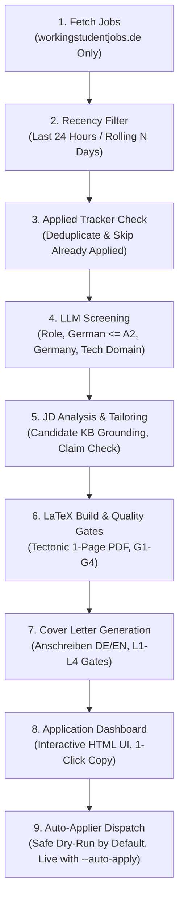

# Auto Application - Working Student & Internship Pipeline

A specialized, autonomous job application pipeline focused exclusively on **[workingstudentjobs.de](https://www.workingstudentjobs.de/)**.

---

## Key Features

1. **Exclusive Source**: Scrapes job listings, JSON-LD, and detailed descriptions solely from `workingstudentjobs.de`.
2. **24-Hour Recency Enforcement**: Strictly filters jobs posted within the rolling 24-hour window (configurable via `--days`).
3. **Pre-Screening Applied Tracker**: Deduplicates against your permanent application history (`data/applied_jobs.json` / `data/applied_jobs.csv`) **before** screening, saving LLM tokens and time.
4. **Intelligent Screening**: Classifies role type, checks German language requirement against your verified CEFR level (A2), confirms Germany location, and filters for Tech/AI/Software domains.
5. **KB-Grounded Resume Tailoring**: Grounds every resume bullet in your verified profile (`candidate_kb.json`) with zero hallucinations.
6. **1-Page LaTeX Compilation & Quality Gates**: Compiles pixel-perfect PDFs with Tectonic and runs G1-G4 gates (1-page fit, contact info, ATS keyword coverage).
7. **Bilingual Cover Letters (Anschreiben)**: Generates tailored German or English cover letters with strict L1-L4 anti-cliché quality gates.
8. **Interactive Review Dashboard**: Modern local HTML dashboard (`dashboard.html`) featuring 1-click clipboard copy for cover letter text, direct PDF downloads, and quick portal links.
9. **Modular Auto-Application Interface**: Pluggable auto-applier architecture with safe dry-run validation by default and live automation hooks.

---

## Pipeline Workflow



---

## Directory Structure

```
auto-application-workingstudent/
├── config.py                 # Central configurations, filepaths, and settings
├── applied_tracker.py        # Application history registry & deduplication engine
├── fetcher.py                # workingstudentjobs.de scraper (JSON-LD + details)
├── recency_filter.py         # Rolling window date parser and filter
├── screener.py               # LLM screening (German, role, tech domain)
├── pipeline_runner.py        # Master pipeline orchestrator
├── auto_applier.py           # Auto-application engine (dry-run & live adapters)
├── dashboard_generator.py    # Generates local interactive dashboard
├── run.py                    # Top-level CLI entrypoint
├── README.md                 # System documentation
└── data/                     # Data storage and generated documents
    ├── applied_jobs.json     # Permanent JSON tracking registry
    ├── applied_jobs.csv      # Spreadsheet-friendly CSV mirror
    ├── fetched_jobs.csv      # Raw scraped jobs
    ├── filtered_jobs.csv     # 24h filtered jobs
    ├── unapplied_jobs.csv    # Jobs not yet applied
    ├── screened_jobs.csv     # Jobs passing LLM screening
    ├── screening_report.csv  # Screening decisions & evidence
    └── dashboard.html        # Interactive application review dashboard
```

---

## Usage Guide

### 1. Launch the Apple-Style Live Dashboard Web App (Recommended)
```bash
cd auto-application-workingstudent
python run.py --dashboard
# or
python server.py --port 8000
```
Open **[http://localhost:8000](http://localhost:8000)** in your browser:
- **Run Program**: Click `▶ Run Program` to trigger the pipeline live.
- **Live Terminal Logs**: Watch real-time streaming logs as stages progress.
- **Apple Segmented Tabs**:
  - **Ready for Application** (Default): Review tailored applications with direct links to Resume PDF, Cover Letter PDF, and 1-click clipboard copy.
  - **Applied**: Track submitted applications with timestamps and undo support.
  - **Fetched Only**: Review scraped jobs that were filtered or pending build.
- **1-Click Mark Applied**: Instantly transitions jobs to the `Applied` tab and permanently updates `applied_jobs.json`.

### 2. Run Headless via CLI (Last 24 Hours)
```bash
python run.py --days 1
```

### 2. Reuse Existing Scraped Data (Skip Web Fetch)
```bash
python run.py --skip-fetch
```

### 3. Change Time Window (e.g., Last 48 Hours)
```bash
python run.py --days 2 --pages 10
```

### 4. Force Regenerate All Resumes and Cover Letters
```bash
python run.py --force --force-letters
```

### 5. Run with Live Auto-Application
*(By default, the pipeline runs in safe dry-run mode where application packages are verified and staged as `ready_to_apply`)*
```bash
python run.py --auto-apply
```

---

## Managing the Applied Tracker

You can manage your application registry directly using the CLI:

```bash
# View summary stats
python applied_tracker.py stats

# List all tracked applications
python applied_tracker.py list

# Check if a specific URL was already applied
python applied_tracker.py check "https://www.workingstudentjobs.de/jobs/..."

# Manually register a completed application
python applied_tracker.py add "https://www.workingstudentjobs.de/jobs/..." --company "Siemens" --title "Working Student AI"

# Sync JSON database to CSV spreadsheet
python applied_tracker.py sync
```

---

## Auto-Applier Architecture

The auto-application module (`auto_applier.py`) is decoupled from document generation:
- **Safety First**: Runs in `dry_run=True` mode by default. It validates that the generated resume PDF, cover letter, candidate email, phone, and enrolment certificate are present and intact before staging.
- **Portal Adapters**: Detects whether an application is via direct Email (`mailto:`), Greenhouse, Lever, Personio, Workday, or a generic web form.
- **Auto-Logging**: Whenever a job is processed or submitted, it automatically registers in `applied_tracker.py`.
